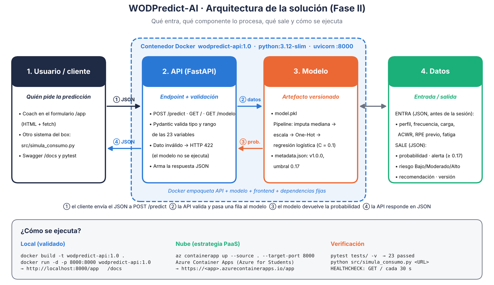
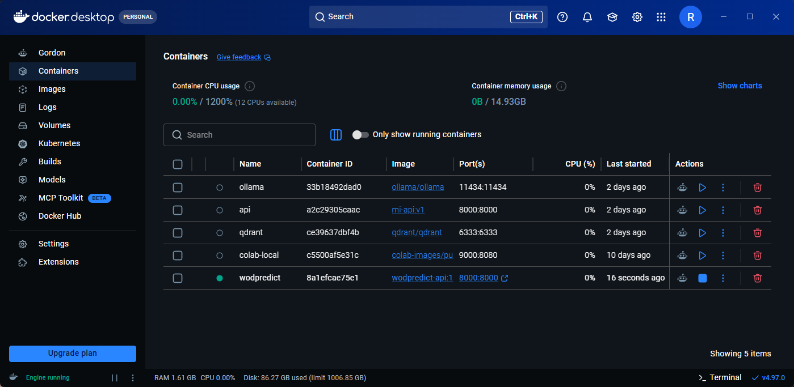
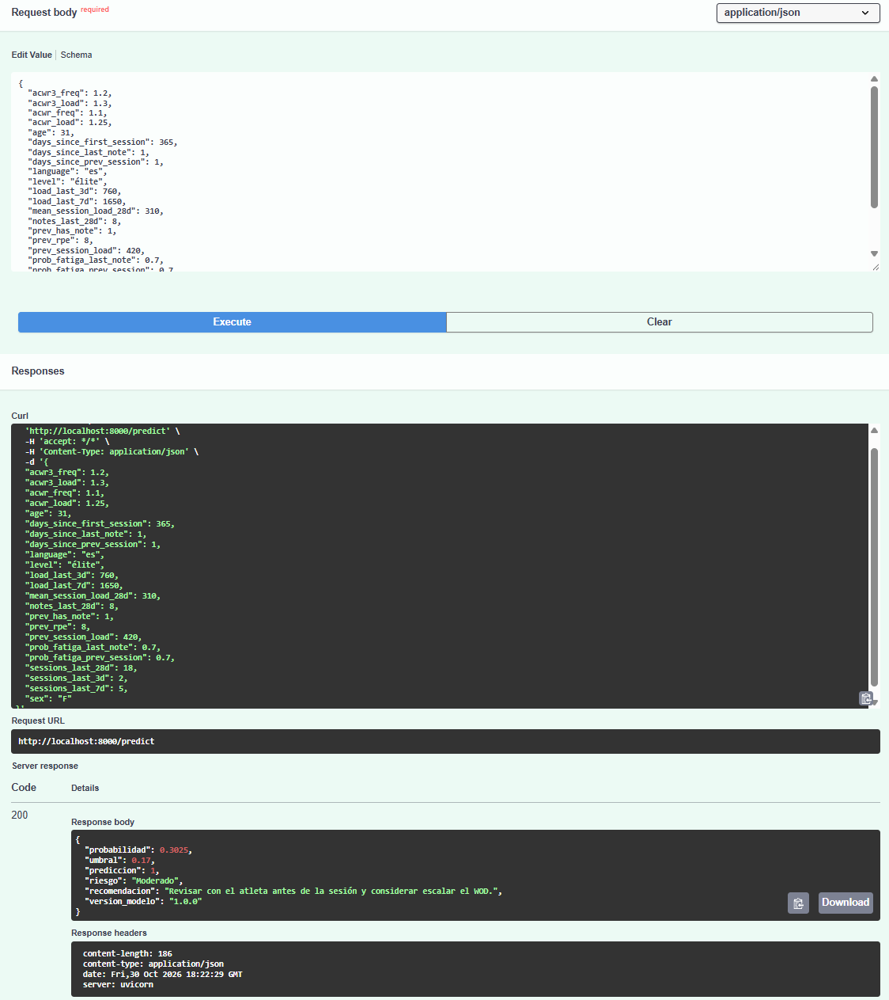
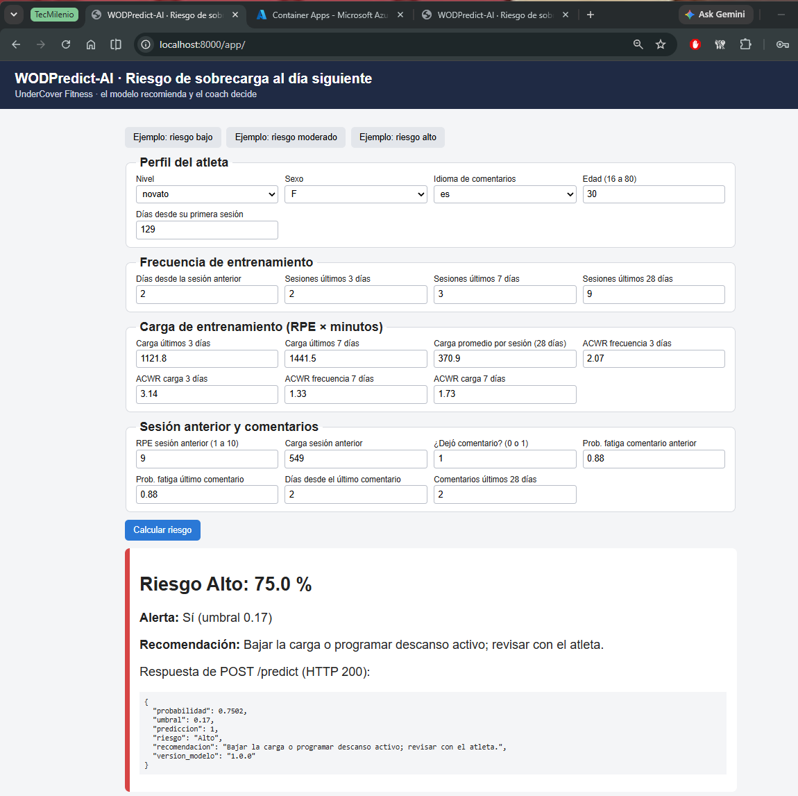
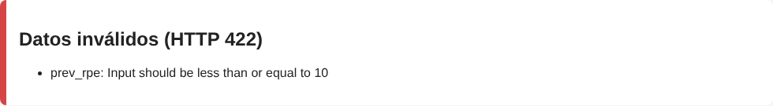
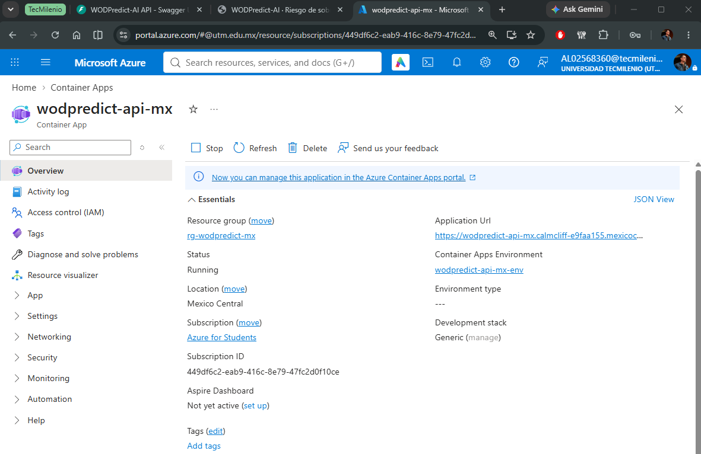

# 🏋️ WODPredict-AI: API de Predicción de Sobrecarga en Docker (Fase II)

> ## 🧭 Capstone journey · WODPredict-AI
>
> This is the **main repository** of the WODPredict-AI Master's Capstone: the deployment-oriented continuation of three earlier repositories (NLP fatigue signal → data & training → evaluation & threshold). See [Related repositories](#-related-repositories) and [Project evolution](#-project-evolution) below.

## 📌 Resumen
**Nombre del proyecto:** WODPredict-AI (Fase II. Ejecución)
Este repositorio contiene la Fase II del proyecto final WODPredict-AI para la red de centros **UnderCover Fitness**. El modelo de sobrecarga de las Actividades 5 y 6 se convierte en una **solución técnica desplegable**: artefacto versionado del modelo, API REST con FastAPI, formulario web que consume la API, contenedor Docker, pruebas automatizadas y manual de despliegue en la nube (Azure).

**Objetivo General:**
Que el coach pueda consultar, **antes de la sesión**, si un atleta tiene riesgo de **sobrecarga al día siguiente** (`overreaching_label` = 1) desde un formulario web o desde cualquier sistema que llame a la API, con el mismo resultado en cualquier computadora gracias a Docker.

**Contexto Profesional:**
Iniciativa alineada al *Business Case* de UnderCover Fitness para reducir la deserción de atletas en un 25% derivada de lesiones por acumulación de fatiga. El modelo recomienda y el coach decide.

## 🧭 Guía rápida para un tercero

| Pregunta | Respuesta |
|---|---|
| ¿Dónde está el modelo? | `model/model.pkl` (pipeline entrenado, 6 KB, guardado con joblib) y `model/metadata.json` (versión, umbral 0.17, variables y métricas). Se carga en `src/model_loader.py`; se entrena con `src/entrenar_modelo.py`. |
| ¿Cómo inicia la API? | `docker run` ejecuta `uvicorn src.app:app` en el puerto 8000 (ver `Dockerfile`). `src/app.py` carga el modelo al iniciar y expone los endpoints. |
| ¿Cómo se ejecutan las pruebas? | Con el contenedor corriendo: `pytest tests/ -v` (23 pruebas). La tabla de casos extremos está en `tests/casos_extremos.md`. |
| ¿Dónde está la documentación? | `docs/manual_despliegue.pdf` (ISO/IEC 23053) y `docs/validacion_pruebas.pdf`. |

## 🏗️ Arquitectura



| Método | Endpoint | Qué hace |
|---|---|---|
| GET | `/` | Health check: ¿el servicio responde? |
| GET | `/modelo` | Ficha del modelo (versión, umbral, métricas en prueba, versiones) |
| POST | `/predict` | Recibe los datos de un atleta (JSON) y devuelve probabilidad, alerta, riesgo y recomendación |
| GET | `/docs` | Documentación interactiva (Swagger) para probar los endpoints |
| GET | `/app` | Formulario web (frontend) que consume `/predict` |

**Ejemplo de request y response de `POST /predict`:**

```json
// Request (perfil de ejemplo: tests/ejemplos/atleta_riesgo_moderado.json)
{"level": "élite", "sex": "F", "language": "es", "age": 31, "days_since_first_session": 365,
 "days_since_prev_session": 1, "sessions_last_3d": 2, "sessions_last_7d": 5, "sessions_last_28d": 18,
 "load_last_3d": 760, "load_last_7d": 1650, "mean_session_load_28d": 310,
 "acwr3_freq": 1.2, "acwr3_load": 1.3, "acwr_freq": 1.1, "acwr_load": 1.25,
 "prev_rpe": 8, "prev_session_load": 420, "prev_has_note": 1,
 "prob_fatiga_prev_session": 0.70, "prob_fatiga_last_note": 0.70,
 "days_since_last_note": 1, "notes_last_28d": 8}

// Response (HTTP 200)
{"probabilidad": 0.3025, "umbral": 0.17, "prediccion": 1, "riesgo": "Moderado",
 "recomendacion": "Revisar con el atleta antes de la sesión y considerar escalar el WOD.",
 "version_modelo": "1.0.0"}
```

Si un dato no cumple el contrato (por ejemplo, `prev_rpe = 11` o falta `load_last_7d`), la API responde **HTTP 422** con el campo que falló y el modelo no se ejecuta.

## 🛠️ Tecnologías Utilizadas
*   **Lenguaje:** Python 3.12
*   **Entorno:** VS Code con las extensiones de Python, Jupyter, Docker y GitHub; Docker Desktop. No requiere GPU.
*   **Modelo:** regresión logística (`C = 0.1`) en un `Pipeline` de scikit-learn, umbral **0.17** (Actividad 6)
*   **API:** FastAPI + Pydantic + uvicorn (REST, JSON)
*   **Frontend:** HTML + JavaScript (`fetch`) servido por la misma API
*   **Contenedor:** Docker (`python:3.12-slim`, usuario sin privilegios, `HEALTHCHECK`)
*   **Pruebas:** pytest + requests (23 pruebas contra el contenedor)
*   **Nube:** Azure Container Apps (PaaS de contenedores) con la cuenta académica Azure for Students
*   **Documentación:** IA generativa como apoyo para código y documentación, con revisión del autor (ver manual, sección 12.3)
*   **Versiones fijas:** `requirements.txt` (imagen de Docker) y `requirements-dev.txt` (entrenamiento, pruebas y notebook)

## 📁 Estructura del Proyecto

Sigue la estructura sugerida en la Sesión 8 (`src/ model/ tests/ docs/`), con dos carpetas adicionales: `frontend/` (formulario web) y `notebooks/` (ejecución por celdas).

```
WODPredict-AI-FaseII/
├── src/
│   ├── app.py                 # API FastAPI: endpoints, contrato de entrada y salida
│   ├── model_loader.py        # dónde está el modelo y cómo se carga (lo usan la API y el notebook)
│   ├── entrenar_modelo.py     # entrena el modelo final y guarda el artefacto en model/
│   └── simula_consumo.py      # cliente externo que consume la API con requests
├── model/
│   ├── model.pkl              # pipeline entrenado (6 KB, guardado con joblib)
│   └── metadata.json          # versión, umbral, variables, métricas y versiones
├── frontend/
│   └── index.html             # formulario que consume POST /predict
├── tests/
│   ├── test_api.py            # 23 pruebas: funcionales, extremos, validación, consistencia y latencia
│   ├── casos_extremos.md      # tabla de casos extremos: entrada, esperado, real y conclusión
│   └── ejemplos/              # 3 perfiles de atleta en JSON (riesgo bajo, moderado y alto)
├── notebooks/
│   └── fase2_ejecucion.ipynb  # notebook por celdas: modelo -> API -> Docker -> pruebas
├── docs/
│   ├── manual_despliegue.pdf  # manual de despliegue en la nube (ISO/IEC 23053)
│   ├── validacion_pruebas.pdf # documento de validación y pruebas
│   ├── openapi.json           # contrato completo de la API
│   └── capturas/              # diagrama de arquitectura y capturas de evidencia
├── Dockerfile                 # receta de la imagen
├── .dockerignore              # lo que no entra a la imagen
├── requirements.txt           # dependencias de la API (versiones fijas)
├── requirements-dev.txt       # dependencias extra para desarrollo y pruebas
├── .gitignore                 # lo que se queda solo en local
└── README.md
```

## 🔌 Evidencia de Integración

| Evidencia | Dónde verla |
|---|---|
| Diagrama de arquitectura y tabla de endpoints | Esta página (sección Arquitectura) |
| Contrato completo de la API (OpenAPI 3.1) | [`docs/openapi.json`](docs/openapi.json) o http://localhost:8000/docs |
| Request y response reales dentro del contenedor | `notebooks/fase2_ejecucion.ipynb`, punto 6 |
| Frontend consumiendo `POST /predict` | `frontend/index.html` (`fetch("/predict")`) y captura de abajo |
| Cliente externo consumiendo la API | `src/simula_consumo.py` y notebook, punto 6.1 |
| Pruebas automatizadas de cada endpoint | `tests/test_api.py` y notebook, punto 9 (salida de pytest) |

**Contenedor `wodpredict` en ejecución (Docker Desktop):**



**Swagger `/docs`: `POST /predict` ejecutado dentro del contenedor (HTTP 200):**



**Formulario `/app` consumiendo `POST /predict` dentro del contenedor (perfil de riesgo alto):**



**La API rechaza datos inválidos (RPE = 11) con HTTP 422 y señala el campo:**



**Cliente externo (`python src/simula_consumo.py`):**

```
GET / -> HTTP 200: {'mensaje': 'API funcionando', 'modelo': 'WODPredict-AI - sobrecarga al día siguiente', 'version': '1.0.0'}

Atleta de ejemplo 'bajo' -> HTTP 200
  Riesgo Bajo (3.0%) | alerta: 0
  Recomendación: Entrenar según lo planeado.

Atleta de ejemplo 'moderado' -> HTTP 200
  Riesgo Moderado (30.2%) | alerta: 1
  Recomendación: Revisar con el atleta antes de la sesión y considerar escalar el WOD.

Atleta de ejemplo 'alto' -> HTTP 200
  Riesgo Alto (75.0%) | alerta: 1
  Recomendación: Bajar la carga o programar descanso activo; revisar con el atleta.

Dato inválido (prev_rpe = 11) -> HTTP 422: prev_rpe - Input should be less than or equal to 10
```

## 📋 Requisitos

| Requisito | Versión | Para qué |
|---|---|---|
| Docker Desktop (con WSL 2 en Windows) | 4.x | Construir y ejecutar la imagen |
| Git | 2.x | Clonar el repositorio |
| Python | 3.12 | Solo para pruebas, cliente externo y notebook (la API corre dentro de Docker) |
| VS Code | Extensiones Python, Jupyter y Docker | Ejecutar el notebook y administrar contenedores |
| Azure CLI + cuenta Azure for Students | 2.6x o superior | Solo para el despliegue en la nube |
| Hardware | 4 GB de RAM libres y 2 GB de disco | La imagen ocupa ≈ 690 MB |

## ⚙️ Instalación, Build, Run y Prueba

> Los comandos son para **PowerShell en Windows** con VS Code. En Linux/WSL cambia `.\.venv\Scripts\Activate.ps1` por `source .venv/bin/activate`.

### 1. Instalación
```powershell
git clone https://github.com/rick-lastra/WODPredict-AI-FaseII.git
cd WODPredict-AI-FaseII
code .
```
Para las pruebas, el cliente externo y el notebook se crea el ambiente de Python (la API no lo necesita, corre dentro de Docker):
```powershell
py -3.12 -m venv .venv
.\.venv\Scripts\Activate.ps1
pip install -r requirements-dev.txt
```

### 2. Build (construir la imagen)
Con Docker Desktop abierto:
```powershell
docker build -t wodpredict-api:1.0 .
```

### 3. Run (ejecutar el contenedor)
```powershell
docker run -d --name wodpredict -p 8000:8000 wodpredict-api:1.0
docker ps        # el estado debe decir (healthy)
```
La API queda disponible en http://localhost:8000 (formulario en `/app` y Swagger en `/docs`).

### 4. Prueba
*   **Formulario:** http://localhost:8000/app (botón *Ejemplo: riesgo alto* y luego *Calcular riesgo*)
*   **Swagger:** http://localhost:8000/docs (`POST /predict` > *Try it out* > *Execute*)
*   **Terminal:**
    ```powershell
    Invoke-RestMethod -Uri http://localhost:8000/predict -Method Post -ContentType "application/json" -InFile tests/ejemplos/atleta_riesgo_alto.json
    ```
*   **Cliente externo** (otro sistema que consume la API): `python src/simula_consumo.py`
*   **Pruebas automatizadas** (23 pruebas, con el contenedor corriendo): `pytest tests/ -v`

## ☁️ Despliegue en la Nube
La estrategia es **contenedores + PaaS**: la misma imagen que se probó en local se publica en **Azure Container Apps** (región **Mexico Central**) con la cuenta académica **Azure for Students**. Azure administra servidores, HTTPS y escalado, y cobra solo por uso (con capa gratuita mensual). El paso a paso, los requerimientos técnicos y las restricciones de la suscripción de estudiante (MFA, regiones permitidas y build en la nube bloqueado) están en [`docs/manual_despliegue.pdf`](docs/manual_despliegue.pdf), basado en la norma **ISO/IEC 23053:2022**.

**Demo pública:** se desplegó en Azure Container Apps durante la evaluación y luego se apagó para no consumir créditos. Las capturas de [`docs/capturas/`](docs/capturas/) y el [manual de despliegue](docs/manual_despliegue.pdf) documentan el resultado; la imagen se recrea con los comandos de abajo.

*URL que tuvo la demo (ya no responde):* https://wodpredict-api-mx.calmcliff-e9faa155.mexicocentral.azurecontainerapps.io/app

```powershell
az login
az group create -n rg-wodpredict-mx -l mexicocentral
az acr create -n wodpredictal02568360 -g rg-wodpredict-mx -l mexicocentral --sku Basic --admin-enabled true
az acr login -n wodpredictal02568360
docker tag wodpredict-api:1.0 wodpredictal02568360.azurecr.io/wodpredict-api:1.0
docker push wodpredictal02568360.azurecr.io/wodpredict-api:1.0
$clave = az acr credential show -n wodpredictal02568360 --query "passwords[0].value" -o tsv
az containerapp up --name wodpredict-api-mx --resource-group rg-wodpredict-mx --location mexicocentral `
    --image wodpredictal02568360.azurecr.io/wodpredict-api:1.0 --registry-server wodpredictal02568360.azurecr.io `
    --registry-username wodpredictal02568360 --registry-password $clave --ingress external --target-port 8000
```



## 🧪 Validación y Resultados

| Prueba | Resultado |
|---|---|
| Build de la imagen | Sin errores; contenedor en estado *healthy* |
| Portabilidad | Misma probabilidad con el modelo directo, la API local y la API en Docker (3 perfiles) |
| Funcionales y casos extremos | 14 de 14 casos con el resultado esperado |
| pytest | 23 de 23 pruebas aprobadas |
| Latencia de `POST /predict` | Mediana 17.3 ms, percentil 95 22.4 ms (meta: < 100 ms y < 300 ms) |
| Azure Container Apps (Mexico Central) | Mismas probabilidades que en local; pytest 22 de 23 (L01: ≈ 1.1 s por consulta en la nube, fuera de la meta local; ver análisis en el documento de validación) |
| Métricas del modelo (prueba, 56 atletas nuevos) | Recall 0.732, precisión 0.378, F1 0.498, ROC-AUC 0.859 |

El detalle de cada caso (entrada, esperado, real y conclusión) está en [`tests/casos_extremos.md`](tests/casos_extremos.md) y en [`docs/validacion_pruebas.pdf`](docs/validacion_pruebas.pdf).

## ✅ Criterios

| Criterio | Evidencia en este repositorio |
| --- | --- |
| 1. Contenerización y despliegue local | `Dockerfile`, `.dockerignore`, `HEALTHCHECK`, notebook puntos 4 y 5, tabla de portabilidad (punto 6) |
| 2. Integración técnica (API, frontend/backend) | `src/app.py`, `frontend/index.html`, `src/simula_consumo.py`, `docs/openapi.json`, sección Evidencia de Integración |
| 3. Pruebas y validación del modelo | `tests/test_api.py` (23 pruebas), `tests/casos_extremos.md`, notebook puntos 7 a 9, `docs/validacion_pruebas.pdf` |
| 4. Documentación y repositorio | Este README, estructura `src/ model/ tests/ docs/`, `.gitignore`, `docs/manual_despliegue.pdf` (ISO/IEC 23053) |

## 📚 Documentación

| Documento | Contenido |
|---|---|
| [`docs/manual_despliegue.pdf`](docs/manual_despliegue.pdf) | Manual de despliegue en la nube basado en ISO/IEC 23053: arquitectura, requerimientos, pipeline de despliegue local y en Azure, monitoreo, riesgos y uso de IA generativa |
| [`docs/validacion_pruebas.pdf`](docs/validacion_pruebas.pdf) | Documento de validación y pruebas: entorno, casos, resultados y análisis |
| [`tests/casos_extremos.md`](tests/casos_extremos.md) | Tabla de casos extremos y validación de entrada |
| [`docs/openapi.json`](docs/openapi.json) | Contrato completo de la API (OpenAPI 3.1) |
| [`notebooks/fase2_ejecucion.ipynb`](notebooks/fase2_ejecucion.ipynb) | Ejecución por celdas con salidas: modelo, API, Docker y pruebas |

## ⚠️ Limitaciones
*   El modelo se entrenó con datos sintéticos; el piloto con datos reales de Wodify está planeado para noviembre de 2026.
*   La API recibe las variables `prob_fatiga_*` ya calculadas, igual que en el dataset de entrenamiento.
*   La API no tiene autenticación; antes de usarla con datos reales de atletas se debe agregar (ver manual, sección de riesgos).

## 🧩 Related repositories

This project builds on earlier exploratory work. Each repository answers one question and says in its own README how it feeds this one.

| Stage | Repository | Role | What this repo reuses | Status |
|---|---|---|---|---|
| 1 | [WODPredictAI (Activity 4)](https://github.com/rick-lastra/WODPredictAI) | **Model comparison (NLP):** three pretrained Hugging Face models evaluated on 84 coach-labelled comments | `prob_fatiga` signal (XLM-R), used as two input features | `exploratory`, superseded |
| 2 | [Actividad_5](https://github.com/rick-lastra/Actividad_5) | **Data preparation and training:** synthetic dataset, cleaning, leakage removal, three models, MLflow | Dataset `v1.0`, 23 leakage-free features, logistic regression | `archived`, superseded |
| 3 | [Actividad_6](https://github.com/rick-lastra/Actividad_6) | **Model evaluation:** threshold tuning, ROC and cross-validation, baselines, simulated A/B test | Threshold 0.17 and reference metrics | `archived`, superseded |

The business case that frames the whole project (UnderCover Fitness, Phase I) was delivered as a written report and is not a repository. There is no separate deployment-experiments repository: the API, container and cloud deployment live in this repo.

## 🔄 Project evolution

This repository is the deployment-oriented continuation of those earlier repositories, whose work covers data exploration, feature engineering, model comparison and initial experiments.

1. **Activity 4:** a fatigue signal is extracted from athlete comments with a pretrained NLP model.
2. **Activity 5:** that signal and training-load features feed a next-day overreaching classifier; logistic regression is selected.
3. **Activity 6:** the model is evaluated on unseen athletes and the decision threshold is set to 0.17.
4. **Phase II (this repo):** the selected model becomes a versioned artifact served by a FastAPI service with a web form, a Docker image, 23 automated tests and a deployment on Azure Container Apps.

Earlier stages use synthetic data (plus the author's own personal SugarWOD training log in Activities 4 and 5) and experimental notebooks; they are kept for technical traceability. What is still pending is validation with real data (Wodify pilot, planned for November 2026) and authentication for the API.

## 🔗 Enlaces
*   Actividad 4 (módulo NLP de fatiga con Hugging Face): https://github.com/rick-lastra/WODPredictAI
*   Actividad 5 (datos y entrenamiento con MLflow): https://github.com/rick-lastra/Actividad_5
*   Actividad 6 (evaluación, validación y umbral): https://github.com/rick-lastra/Actividad_6
*   Dataset sintético en Hugging Face (versión `v1.0`): https://huggingface.co/datasets/rick-lastra/wodpredict-synth

## 👥 Contacto y Créditos
*   **Autor:** Ricardo Alejandro Lastra Dueñas
*   **Empresa (Caso de Uso):** UnderCover Fitness
*   **Fecha:** Noviembre 2026
*   **Institución:** Universidad Tecmilenio (Gestión de Proyectos de IA)
